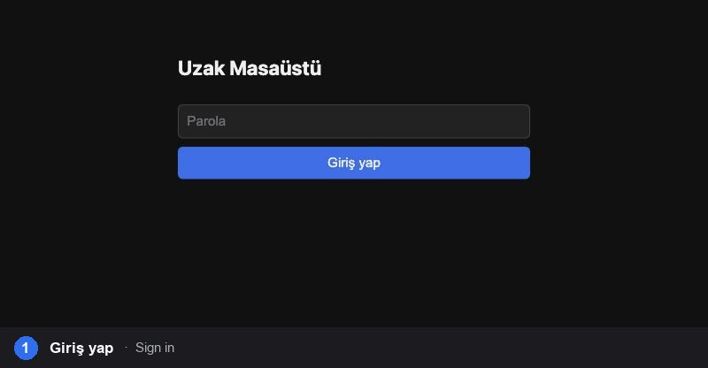

# Open Remote Desktop

[](https://github.com/ozkurtomer/open-remote-desktop/actions/workflows/ci.yml)
[](LICENSE)


**[Türkçe](#türkçe)** · **[English](#english)**

<p align="center">
  
</p>

<p align="center"><sub>
TR: Gerçek arayüz, gerçek sunucu ve gerçek WebRTC bağlantısı (giriş, cihaz listesi, fare ve klavye komutları). GIF'teki uzak masaüstü <b>gerçek bir ekran değil</b>, demo amaçlı çizilmiş örnek bir masaüstüdür.<br>
EN: Real UI, real server and a real WebRTC connection (login, device list, pointer and keyboard input). The remote desktop in the GIF is <b>not a real screen</b>, it is a sample desktop drawn for the demo.
</sub></p>

---

## Türkçe

**Kendi bilgisayarına uzaktan eriş: açık kaynak, ücretsiz, hesap yok, üçüncü taraf uzak masaüstü servisi yok.**

Bilgisayarına uygulamayı kur, bir parola belirle, telefonundan veya başka bir cihazdan tarayıcıyla bağlan. AnyDesk veya TeamViewer'a gerek yok.

### Özellikler

- **Tek paket:** Sunucu, web arayüzü ve internet tüneli uygulamanın içinde gömülü. Ayrıca bir şey kurmazsın.
- **Telefona kurulum yok:** Telefondan sadece tarayıcı. Dokunmatik kontrol: imleç sürükleme, tık, sağ tık, kaydırma, ekran klavyesi, Ctrl/⌘/Esc/ok tuşları.
- **Ücretsiz uzaktan erişim:** Tek tuşla Cloudflare tüneli (hesap açmadan) veya Tailscale ile.
- **Gözetimsiz erişim:** Bilgisayarının başında kimse olmasa da bağlanırsın. Bağlanınca bilgisayarda bildirim çıkar. İstersen "her bağlantıda bana sor" modunu açarsın.
- **Şifreli:** Görüntü ve kontrol WebRTC ile uçtan uca şifrelenir. Parola yalnızca özet (scrypt) olarak saklanır.
- **Tepsi uygulaması:** Pencereyi kapatsan da arka planda çalışır.
- **İsteğe bağlı kurumsal mod:** LDAP/Active Directory, çoklu kullanıcı, VPN içi kurulum: [docs/COMPANY.md](docs/COMPANY.md).

### Nasıl çalışır

```
Telefon (tarayıcı) ──https/wss──▶ [Uygulamanın içindeki sunucu: giriş, eşleştirme]
        ▲                                   │  (aynı Wi-Fi, Cloudflare tüneli veya Tailscale)
        └──── video + fare/klavye: WebRTC (doğrudan, şifreli) ◀──── Uygulama (ekran yakalama, girdi uygulama)
```

Sunucu yalnızca giriş ve bağlantı kurulumunu (signaling) yönetir. Görüntü ve kontrol verisi sunucudan veya tünelden **geçmez**, iki cihaz arasında doğrudan akar.

### Kurulum

[**Releases**](../../releases) sayfasından işletim sistemine uygun dosyayı indir:

| Sistem | Dosya | Durum |
|---|---|---|
| macOS (Apple Silicon) | `OpenRemoteDesktop-*-mac-arm64.dmg` | Denendi (yerel derleme) |
| macOS (Intel) | `OpenRemoteDesktop-*-mac-x64.dmg` | GitHub Actions ile üretilir, **denenmedi** |
| Windows | `OpenRemoteDesktop-*-win-x64.exe` | GitHub Actions ile üretilir, **denenmedi** |
| Linux | `OpenRemoteDesktop-*-linux-x86_64.AppImage` | GitHub Actions ile üretilir, **denenmedi** |

**macOS:** `.dmg`'yi aç, uygulamayı **Applications**'a sürükle. Uygulama Apple'a ücretli kayıtlı bir geliştirici imzası taşımıyor (ücretsiz "ad-hoc" imzalı), bu yüzden ilk açılışta macOS "doğrulanamadı" diyebilir:
- uygulamaya **sağ tık → Aç → Aç**, veya
- `xattr -cr /Applications/OpenRemoteDesktop.app`

Sonra *Sistem Ayarları → Gizlilik ve Güvenlik* altında **Ekran Kaydı** ve **Erişilebilirlik** izinlerini *OpenRemoteDesktop* için ver ve uygulamayı yeniden aç.

> Uygulama arayüzü şu an yalnızca Türkçe.

### Kullanım

1. Uygulamayı aç, **Kişisel (sadece ben)** sekmesinde bir parola belirle (en az 10 karakter, uzun ve benzersiz olsun), **Başlat**'a bas.
2. Pencerede adres ve QR kod çıkar.
3. Telefonda adresi aç (veya QR'ı tara), parolanla giriş yap, bilgisayarını seç, **Bağlan**.

**Telefondaki kontroller:**

| Hareket | Ne yapar |
|---|---|
| Tek parmakla sürükle | İmleci hareket ettirir (dokunmatik yüzey gibi) |
| Tek dokunuş | Sol tık |
| İki parmakla dokun | Sağ tık |
| İki parmakla kaydır | Tekerlek (yukarı/aşağı kaydırma) |
| Uzun bas ve sürükle | Basılı tutup sürükleme |
| **⌨ Klavye** | Ekran klavyesini açar, yazdıkların bilgisayara gider |
| Ctrl, ⌘/Win, Alt | Yapışkan tuşlar: bas, sonra bir harf yaz (Ctrl + C gibi) |
| **İmleç modu / Doğrudan mod** | Doğrudan modda imleç parmağını bastığın yere gider |

#### Başka ağdan (evin dışından) bağlanmak

| Yöntem | Telefona kurulum | Nasıl | Dikkat |
|---|---|---|---|
| **Aynı Wi-Fi** | Yok | Pencerede görünen `http://192.168.x.x:8080` adresi | Yalnızca aynı ağda |
| **Cloudflare tüneli** (uygulamada tek tuş) | Yok | **İnternetten erişimi aç** düğmesi, çıkan `https://...trycloudflare.com` adresi | Adres **internete açık**, yalnızca parolan korur. Adres her açışta değişir. Cloudflare bu özelliği "test/geliştirme amaçlı" olarak sunar, çalışma süresi garantisi yoktur |
| **Tailscale** | Tailscale uygulaması | Her iki cihaza [Tailscale](https://tailscale.com) kur (kişisel kullanım ücretsiz), aynı hesapla gir, pencerede çıkan `100.x.x.x` adresini aç | En güvenli seçenek: internete hiçbir şey açılmaz |

> **Görüntü akışı tünelden geçmez.** Tünel yalnızca giriş ve bağlantı kurulumu içindir. Görüntü, telefon ile bilgisayar arasında doğrudan (WebRTC) akar. Bazı operatör/ağ yapılarında (özellikle mobil veri) doğrudan bağlantı kurulamayabilir ve görüntü gelmeyebilir. Bu durumda aynı Wi-Fi veya Tailscale kullan. Ücretsiz TURN röle desteği yol haritasında.

### Sorun giderme

| Sorun | Çözüm |
|---|---|
| macOS "doğrulanamadı / hasarlı" diyor | Uygulamaya sağ tık → Aç, veya `xattr -cr /Applications/OpenRemoteDesktop.app` |
| Telefonda **"Henüz cihaz yok"** | Bilgisayardaki uygulama açık ve kurulum tamamlanmış olmalı (pencerede "Hazır, uzaktan bağlantı bekleniyor" yazmalı). Uygulamayı yeniden aç |
| Cihaz **çevrimdışı** görünüyor | Uygulama çalışmıyor veya bilgisayar uykuda. Uygulamayı aç, bilgisayarın uyumasını engelle |
| Ekran **siyah** veya "Ekran yakalanamadı" | *Ekran Kaydı* iznini ver, uygulamayı yeniden aç |
| Görüntü var ama **fare/klavye çalışmıyor** | *Erişilebilirlik* iznini ver, uygulamayı yeniden aç |
| Tünel adresi telefonda **açılmıyor** | Yeni adresin DNS'e yayılması birkaç saniye sürebilir. Evdeki router'ın DNS önbelleği de takılabilir: 1-2 dakika bekle, mobil veriyi dene veya telefonun DNS'ini 1.1.1.1 yap |
| **Mobil veride** görüntü gelmiyor | Operatör ağı doğrudan bağlantıya izin vermiyor olabilir. Aynı Wi-Fi veya Tailscale kullan |
| Kurulumda "8080 portu kullanılamıyor" hatası | Başka bir program 8080 portunu kullanıyor. Onu kapatıp tekrar dene |

### Güvenlik

Uygulamayı kullanmadan önce [SECURITY.md](SECURITY.md) dosyasını oku. Özet:
- Adresi router'da port yönlendirerek internete **açma**. Düz HTTP ile parola şifresiz gider; yalnızca Tailscale, kendi Wi-Fi'ın veya HTTPS tüneli üzerinden kullan.
- Tüneli açıkken parolan tek savunma hattın. Uzun ve benzersiz bir parola seç, işin bitince tüneli kapat.
- **Bu proje bağımsız bir güvenlik incelemesinden geçmedi.** Hassas ortamlarda kullanmadan önce kodu kendin incele.
- Yalnızca **sahibi olduğun** bilgisayarlarda kullan.

### Kaynaktan derleme

```bash
git clone https://github.com/ozkurtomer/open-remote-desktop.git
cd open-remote-desktop/host
npm install
npm run fetch-cloudflared   # cloudflared'i indirir (SHA-256 doğrulamalı)
npm start                   # geliştirme
npm run dist                # kurulum paketi üretir (host/dist/)
```
Sunucu testleri: `cd server && npm install && npm test`

### Proje yapısı

| Klasör | Açıklama |
|---|---|
| `host/` | Electron uygulaması: ekran yakalama, fare/klavye uygulama, tepsi, tünel yönetimi |
| `server/` | Giriş, cihaz sahipliği, eşleştirme (signaling), LDAP, testler |
| `viewer/` | Telefon/tarayıcı arayüzü (dokunmatik kontrol dahil) |
| `docs/` | Kurumsal kurulum rehberi, demo GIF |

### Bilinen sınırlar

- Yalnızca birincil ekran paylaşılır; ses yok; pano/dosya aktarımı yok.
- Çift tıklamanın hedef bilgisayarda doğru algılandığı doğrulanmadı.
- Windows'ta UAC/kilit ekranı kontrol edilemez (servis modu yok).
- Windows ve Linux paketleri CI ile üretilir ama gerçek cihazlarda denenmedi.
- Hızlı tünel adresi her açılışta değişir; kalıcı adres için kendi Cloudflare hesabınla adlandırılmış tünel veya Tailscale kullan.
- Uygulama arayüzü yalnızca Türkçe.

### Yol haritası

- [ ] Ücretsiz TURN röle desteği (mobil veride bağlantı için)
- [ ] Windows servis modu, çoklu monitör, pano ve dosya aktarımı
- [ ] İki adımlı doğrulama (TOTP)
- [ ] Çoklu dil desteği (İngilizce arayüz)
- [ ] Apple geliştirici imzası/notarization ve Windows imzalama
- [ ] Otomatik güncelleme

### Katkı ve lisans

PR'lar açıktır, büyük değişikliklerden önce issue açın. Lisans: [MIT](LICENSE). Üçüncü taraf bileşenler: [THIRD_PARTY.md](THIRD_PARTY.md).

---

## English

**Reach your own computer remotely: open source, free, no account, no third-party remote-desktop service.**

Install the app on your computer, set a password, then connect from your phone or any device using just a browser. No AnyDesk or TeamViewer needed.

### Features

- **Single package:** The server, web UI and internet tunnel are all built into the app. Nothing else to install.
- **Nothing to install on your phone:** Just a browser. Touch control: pointer dragging, tap, right-click, scrolling, on-screen keyboard, Ctrl/⌘/Esc/arrow keys.
- **Free remote access:** One-click Cloudflare tunnel (no account needed) or Tailscale.
- **Unattended access:** Connect even when nobody is at the computer. A notification appears on the computer when someone connects. You can turn on "ask me on every connection" if you prefer.
- **Encrypted:** Video and control are end-to-end encrypted with WebRTC. The password is stored only as a hash (scrypt).
- **Tray app:** Keeps running in the background after you close the window.
- **Optional company mode:** LDAP/Active Directory, multiple users, in-VPN setup: [docs/COMPANY.md](docs/COMPANY.md).

### How it works

```
Phone (browser) ──https/wss──▶ [Server inside the app: login, pairing]
        ▲                                │  (same Wi-Fi, Cloudflare tunnel or Tailscale)
        └──── video + pointer/keyboard: WebRTC (direct, encrypted) ◀──── App (screen capture, input injection)
```

The server only handles login and connection setup (signaling). Video and control data do **not** pass through the server or the tunnel: they flow directly between the two devices.

### Installation

Download the right file for your system from the [**Releases**](../../releases) page:

| System | File | Status |
|---|---|---|
| macOS (Apple Silicon) | `OpenRemoteDesktop-*-mac-arm64.dmg` | Tested (local build) |
| macOS (Intel) | `OpenRemoteDesktop-*-mac-x64.dmg` | Built by GitHub Actions, **untested** |
| Windows | `OpenRemoteDesktop-*-win-x64.exe` | Built by GitHub Actions, **untested** |
| Linux | `OpenRemoteDesktop-*-linux-x86_64.AppImage` | Built by GitHub Actions, **untested** |

**macOS:** Open the `.dmg` and drag the app to **Applications**. The app is not signed with a paid Apple developer certificate (it uses a free "ad-hoc" signature), so macOS may say it "cannot be verified" on first launch:
- **right-click the app → Open → Open**, or
- run `xattr -cr /Applications/OpenRemoteDesktop.app`

Then grant **Screen Recording** and **Accessibility** permissions to *OpenRemoteDesktop* under *System Settings → Privacy & Security*, and reopen the app.

> The app's interface is currently Turkish only.

### Usage

1. Open the app, set a password in the **Kişisel (sadece ben)** ("Personal, just me") tab (at least 10 characters, long and unique), then press **Başlat** ("Start").
2. The window shows an address and a QR code.
3. On your phone, open the address (or scan the QR), sign in with your password, pick your computer, and tap **Bağlan** ("Connect").

**Phone controls:**

| Gesture | What it does |
|---|---|
| Drag with one finger | Moves the pointer (like a trackpad) |
| Single tap | Left click |
| Two-finger tap | Right click |
| Two-finger swipe | Scroll wheel |
| Long press and drag | Press-and-hold drag |
| **⌨ Klavye** | Opens the on-screen keyboard; what you type goes to the computer |
| Ctrl, ⌘/Win, Alt | Sticky keys: tap, then type a letter (e.g. Ctrl + C) |
| **İmleç modu / Doğrudan mod** | Pointer mode / direct mode (in direct mode the pointer jumps to where you touch) |

#### Connecting from another network (away from home)

| Method | Phone setup | How | Notes |
|---|---|---|---|
| **Same Wi-Fi** | None | The `http://192.168.x.x:8080` address shown in the window | Same network only |
| **Cloudflare tunnel** (one button in the app) | None | The **İnternetten erişimi aç** ("Open internet access") button, then the `https://...trycloudflare.com` address | The address is **open to the internet** and only your password protects it. The address changes every time. Cloudflare offers this feature for "testing and development", with no uptime guarantee |
| **Tailscale** | Tailscale app | Install [Tailscale](https://tailscale.com) on both devices (free for personal use), sign in with the same account, then open the `100.x.x.x` address shown in the window | Safest option: nothing is exposed to the internet |

> **Video does not go through the tunnel.** The tunnel only carries login and connection setup. Video flows directly (WebRTC) between your phone and your computer. On some carrier/network setups (especially mobile data) a direct connection may fail and no video appears. In that case use the same Wi-Fi or Tailscale. Free TURN relay support is on the roadmap.

### Troubleshooting

| Problem | Fix |
|---|---|
| macOS says "cannot be verified / damaged" | Right-click the app → Open, or `xattr -cr /Applications/OpenRemoteDesktop.app` |
| Phone shows **"no devices yet"** ("Henüz cihaz yok") | The app on your computer must be running with setup complete (the window should say "ready, waiting for a remote connection"). Reopen the app |
| Device shows as **offline** | The app is not running or the computer is asleep. Open the app and prevent the computer from sleeping |
| Screen is **black** or "screen could not be captured" | Grant the *Screen Recording* permission and reopen the app |
| Video works but **pointer/keyboard don't** | Grant the *Accessibility* permission and reopen the app |
| Tunnel address **won't open** on the phone | A new address can take a few seconds to propagate in DNS. Your home router's DNS cache can also lag: wait 1-2 minutes, try mobile data, or set the phone's DNS to 1.1.1.1 |
| No video on **mobile data** | The carrier network may block direct connections. Use the same Wi-Fi or Tailscale |
| Setup fails with "port 8080 cannot be used" | Another program is using port 8080. Close it and try again |

### Security

Read [SECURITY.md](SECURITY.md) before use. In short:
- Do **not** expose the address to the internet with router port forwarding. Plain HTTP sends the password unencrypted; use it only over Tailscale, your own Wi-Fi, or the HTTPS tunnel.
- While the tunnel is open your password is the only line of defense. Pick a long, unique password and close the tunnel when you are done.
- **This project has not had an independent security review.** Review the code yourself before using it in sensitive environments.
- Use it only on computers **you own**.

### Build from source

```bash
git clone https://github.com/ozkurtomer/open-remote-desktop.git
cd open-remote-desktop/host
npm install
npm run fetch-cloudflared   # downloads cloudflared (SHA-256 verified)
npm start                   # development
npm run dist                # builds the installer (host/dist/)
```
Server tests: `cd server && npm install && npm test`

### Project layout

| Folder | Description |
|---|---|
| `host/` | Electron app: screen capture, pointer/keyboard injection, tray, tunnel management |
| `server/` | Login, device ownership, pairing (signaling), LDAP, tests |
| `viewer/` | Phone/browser UI (including touch control) |
| `docs/` | Company setup guide, demo GIF |

### Known limitations

- Only the primary display is shared; no audio; no clipboard or file transfer.
- Double-click detection on the target computer has not been verified.
- On Windows, the UAC prompt and lock screen cannot be controlled (no service mode).
- Windows and Linux packages are built by CI but have not been tested on real devices.
- The quick tunnel address changes on every start; for a permanent address use a named tunnel with your own Cloudflare account, or Tailscale.
- The app interface is Turkish only.

### Roadmap

- [ ] Free TURN relay support (for mobile data)
- [ ] Windows service mode, multi-monitor, clipboard and file transfer
- [ ] Two-factor authentication (TOTP)
- [ ] Multi-language support (English UI)
- [ ] Apple developer signing/notarization and Windows code signing
- [ ] Auto-update

### Contributing and license

Pull requests are welcome; please open an issue before large changes. License: [MIT](LICENSE). Third-party components: [THIRD_PARTY.md](THIRD_PARTY.md).
